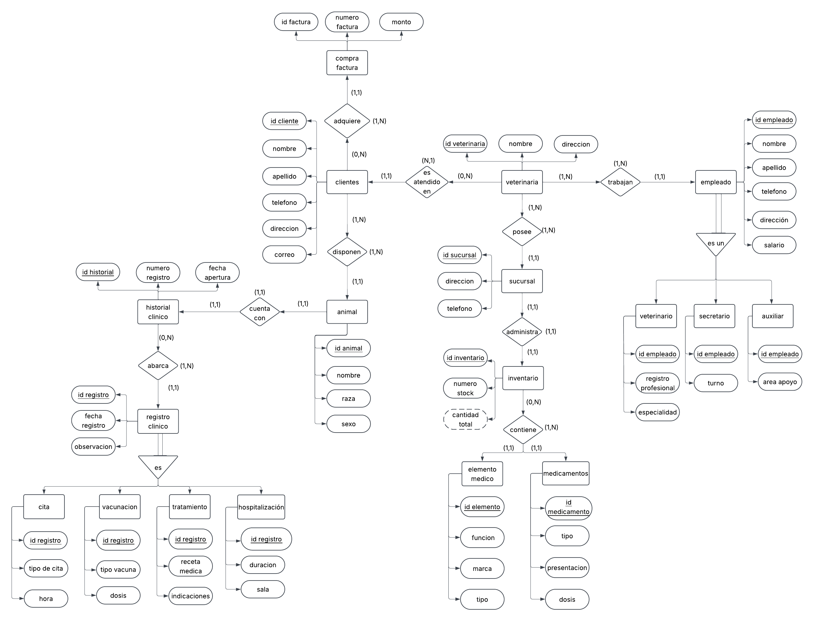

# Modelo E-R

**Primera entrega · PetManager · Bases de Datos I**

[Volver al inicio del repositorio](../README.md) · [Consultar la segunda entrega](../Modelo%20Relacional/)

Esta carpeta reúne los archivos de la primera entrega: el análisis del problema de información de una clínica veterinaria, la investigación del dominio y el modelo entidad-relación.

## Organización de la entrega

| Carpeta | Contenido | Archivo principal |
| --- | --- | --- |
| [Documento](./Documento/) | Documento consolidado con contexto, alcance, tendencias, comparación de herramientas y referencias. | [Primera entrega](./Documento/README.md) |
| [Modelo](./Modelo/) | Diagramas utilizados durante el proceso de modelado. | [Modelo E-R](./Modelo/Modelo_Entidad_Relacion.png) |
| [Investigacion](./Investigacion/) | Exploración inicial del dominio y de sistemas de gestión veterinaria. | [Exploración](./Investigacion/Exploracion.md) |

## Contenido

- Contexto del problema y necesidades de información de la veterinaria.
- Conceptos del dominio y reglas de negocio.
- Tendencias del sector y su relación con el diseño de datos.
- Herramientas de gestión veterinaria.
- Modelo entidad-relación y referencias de la investigación.

## Diagrama de la primera entrega

[Ver diagrama en tamaño completo](./Modelo/Modelo_Entidad_Relacion.png) · [Consultar la primera propuesta](./Modelo/Primera_Propuesta.png)

La primera propuesta se conserva como antecedente del proceso. El diagrama utilizado en la entrega se encuentra en `Modelo_Entidad_Relacion.png`.

## Continuación del proyecto

A partir de las entidades y relaciones del modelo E-R se construyó el modelo relacional, disponible en [Modelo Relacional](../Modelo%20Relacional/).
