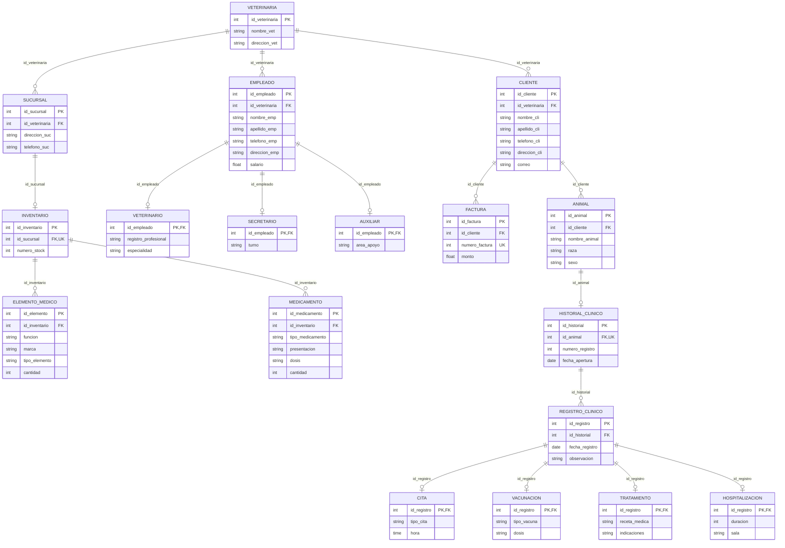

# Modelo relacional de PetManager - 5FN

[Volver a normalización](./README.md) · [Excel original](../../Modelo%20Relacional/Modelo%20Relacional%20Normalizado/ModeloRelacionalNormalizadoPetManager.xlsx) · [SQL de las 18 tablas](../../SQL/02_Creacion_de_tablas/basededatosVeterinaria.sql)

## Diagrama del modelo relacional

## Relaciones del modelo

**Convenciones:** atributo <u>subrayado</u> = **PK**; **(FK)** = clave foránea; **(UK)** = atributo único. En las especializaciones, una clave primaria también puede funcionar como clave foránea.

1. **VETERINARIA**(<u>id_veterinaria</u>, nombre_vet, direccion_vet)
2. **SUCURSAL**(<u>id_sucursal</u>, id_veterinaria (FK), direccion_suc, telefono_suc)
3. **INVENTARIO**(<u>id_inventario</u>, id_sucursal (FK) (UK), numero_stock)
4. **ELEMENTO_MEDICO**(<u>id_elemento</u>, id_inventario (FK), funcion, marca, tipo_elemento, cantidad)
5. **MEDICAMENTO**(<u>id_medicamento</u>, id_inventario (FK), tipo_medicamento, presentacion, dosis, cantidad)
6. **TRATAMIENTO**(<u>id_registro</u> (FK), receta_medica, indicaciones)
7. **EMPLEADO**(<u>id_empleado</u>, id_veterinaria (FK), nombre_emp, apellido_emp, telefono_emp, direccion_emp, salario)
8. **VETERINARIO**(<u>id_empleado</u> (FK), registro_profesional, especialidad)
9. **SECRETARIO**(<u>id_empleado</u> (FK), turno)
10. **AUXILIAR**(<u>id_empleado</u> (FK), area_apoyo)
11. **CITA**(<u>id_registro</u> (FK), tipo_cita, hora)
12. **VACUNACION**(<u>id_registro</u> (FK), tipo_vacuna, dosis)
13. **CLIENTE**(<u>id_cliente</u>, id_veterinaria (FK), nombre_cli, apellido_cli, telefono_cli, direccion_cli, correo)
14. **FACTURA**(<u>id_factura</u>, id_cliente (FK), numero_factura (UK), monto)
15. **ANIMAL**(<u>id_animal</u>, id_cliente (FK), nombre_animal, raza, sexo)
16. **HISTORIAL_CLINICO**(<u>id_historial</u>, id_animal (FK) (UK), numero_registro, fecha_apertura)
17. **REGISTRO_CLINICO**(<u>id_registro</u>, id_historial (FK), fecha_registro, observacion)
18. **HOSPITALIZACION**(<u>id_registro</u> (FK), duracion, sala)

## Enlaces entre las relaciones

Las siguientes referencias corresponden a las **17 claves foráneas del SQL** y muestran la correspondencia entre las tablas.

| Relación dependiente (FK) | Referencia a la PK | Restricción |
| --- | --- | --- |
| `SUCURSAL.id_veterinaria` | `VETERINARIA.id_veterinaria` | Varias filas hijas posibles |
| `INVENTARIO.id_sucursal` | `SUCURSAL.id_sucursal` | Una fila hija por identificador de padre, como máximo |
| `ELEMENTO_MEDICO.id_inventario` | `INVENTARIO.id_inventario` | Varias filas hijas posibles |
| `MEDICAMENTO.id_inventario` | `INVENTARIO.id_inventario` | Varias filas hijas posibles |
| `EMPLEADO.id_veterinaria` | `VETERINARIA.id_veterinaria` | Varias filas hijas posibles |
| `VETERINARIO.id_empleado` | `EMPLEADO.id_empleado` | Una fila hija por identificador de padre, como máximo |
| `SECRETARIO.id_empleado` | `EMPLEADO.id_empleado` | Una fila hija por identificador de padre, como máximo |
| `AUXILIAR.id_empleado` | `EMPLEADO.id_empleado` | Una fila hija por identificador de padre, como máximo |
| `CLIENTE.id_veterinaria` | `VETERINARIA.id_veterinaria` | Varias filas hijas posibles |
| `FACTURA.id_cliente` | `CLIENTE.id_cliente` | Varias filas hijas posibles |
| `ANIMAL.id_cliente` | `CLIENTE.id_cliente` | Varias filas hijas posibles |
| `HISTORIAL_CLINICO.id_animal` | `ANIMAL.id_animal` | Una fila hija por identificador de padre, como máximo |
| `REGISTRO_CLINICO.id_historial` | `HISTORIAL_CLINICO.id_historial` | Varias filas hijas posibles |
| `CITA.id_registro` | `REGISTRO_CLINICO.id_registro` | Una fila hija por identificador de padre, como máximo |
| `VACUNACION.id_registro` | `REGISTRO_CLINICO.id_registro` | Una fila hija por identificador de padre, como máximo |
| `TRATAMIENTO.id_registro` | `REGISTRO_CLINICO.id_registro` | Una fila hija por identificador de padre, como máximo |
| `HOSPITALIZACION.id_registro` | `REGISTRO_CLINICO.id_registro` | Una fila hija por identificador de padre, como máximo |

## Correspondencia con el Excel y el SQL

- **Excel:** los atributos y las claves PK, FK y UK coinciden con la hoja `5FN`. Se respetan los nombres y el orden por relación, así como las 18 relaciones documentadas.
- **Tipos:** el Excel expresa dominios generales (`int`, `string`, `float`, `date`, `time`). El SQL concreta `string` como `VARCHAR` o `TEXT`, y `float` para montos y salarios como `DECIMAL`, sin modificar el propósito del atributo.
- **Obligatoriedad:** los atributos señalados como `NN` en Excel son `NOT NULL` en SQL. Las claves primarias también son obligatorias. `registro_clinico.observacion` admite `NULL`.
- **Atributo derivado:** `cantidad_total` no es una columna física. Se calcula a partir de las cantidades de medicamentos y elementos médicos.
- **Normalización:** bajo las dependencias documentadas, el modelo se conserva en **18 relaciones desde 1FN hasta 5FN**, incluida BCNF. La descomposición de **54 relaciones en 6FN** se documentó como un ejercicio, pero no se implementó.

> **Para exponer:** «El Excel muestra las mismas 18 relaciones que implementamos en SQL. Se revisaron las dependencias hasta quinta forma normal y, bajo las reglas del modelo, no fue necesaria una nueva descomposición. Las claves subrayadas identifican cada relación y las claves foráneas muestran cómo se enlazan».

[Informe de normalización](../../Modelo%20Relacional/Informe%20de%20Normalizaci%C3%B3n/Informe_Normalizacion_PetManager.pdf) · [Siguiente: esquema SQL](../04_Base_de_datos_en_SQL/)
