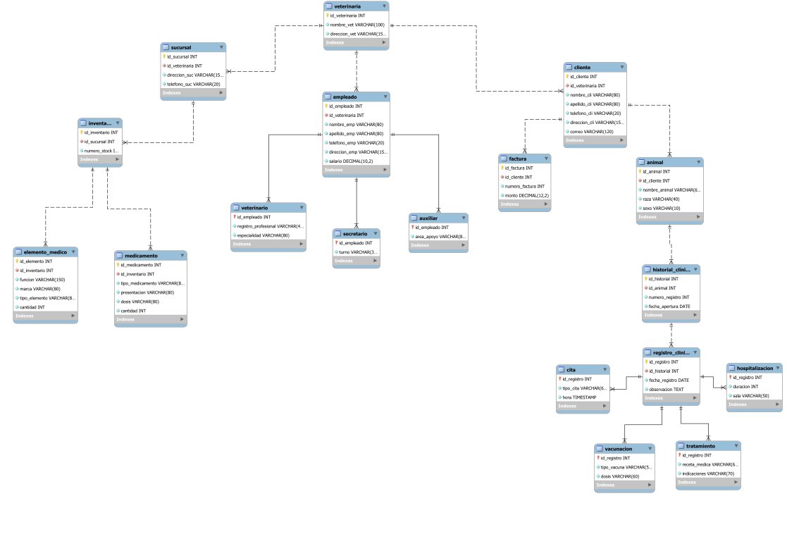

# Modelo relacional de PetManager - 5FN

[Volver a normalización](./README.md) · [Modelo relacional en Excel](../../Modelo%20Relacional/Modelo%20Relacional%20Normalizado/ModeloRelacionalNormalizadoPetManager.xlsx) · [Esquema SQL](../../SQL/02_Creacion_de_tablas/basededatosVeterinaria.sql)

El diagrama presenta las 18 tablas con los tipos utilizados en SQL. La [correspondencia entre el modelo y la implementación](../../SQL/03_Modificaciones/) describe los dominios y la obligatoriedad de los atributos.

## Diagrama del modelo relacional

  

[Ampliar diagrama SVG](https://raw.githubusercontent.com/Stivencaballero0710/Petmanager/main/Sustentaci%C3%B3n/03_Modelo_relacional_y_normalizacion/Modelo_Relacional_PetManager.svg) · [Abrir archivo SVG](./Modelo_Relacional_PetManager.svg) · [Modelo editable de MySQL Workbench (.mwb)](./Modelo_Relacional_PetManager.mwb)

## Consideraciones de implementación

- `registro_clinico.observacion` es `TEXT NOT NULL`; cada registro incluye una observación.
- `cita.hora` utiliza `TIMESTAMP` y conserva la fecha y la hora de la cita.
- Los montos y salarios utilizan los tipos `DECIMAL(12,2)` y `DECIMAL(10,2)`, respectivamente.
- `numero_stock` es el campo de inventario almacenado. `cantidad_total` no se implementa como columna física.
- Las claves foráneas únicas limitan a un inventario por sucursal y a un historial clínico por animal.

[Informe de normalización](../../Modelo%20Relacional/Informe%20de%20Normalizaci%C3%B3n/Informe_Normalizacion_PetManager.pdf) · [Siguiente: Esquema SQL](../04_Base_de_datos_en_SQL/)

