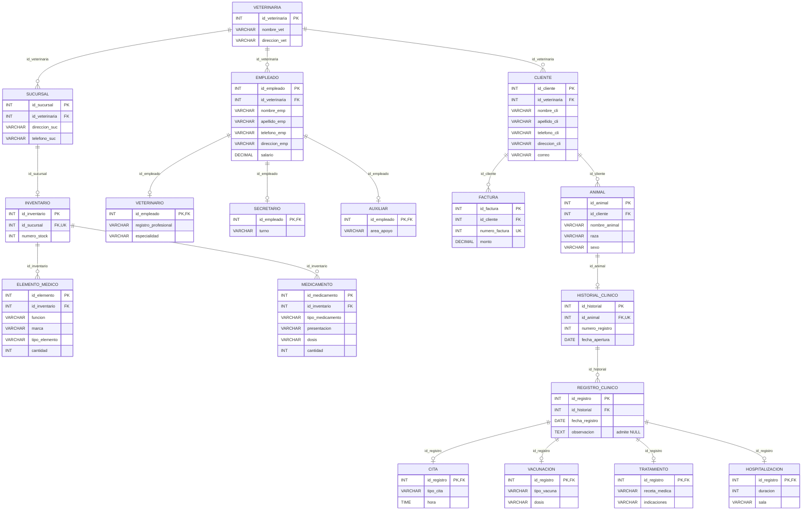

# Modelo relacional de PetManager: estructura seleccionada hasta 5FN

[Volver al apartado de normalización](./README.md) · [Ver esquema SQL](../../SQL/02_Creacion_de_tablas/basededatosVeterinaria.sql)

Este modelo corresponde a las **18 tablas implementadas en MySQL**, cuya estructura se mantuvo en la revisión desde 1FN hasta **5FN**, incluida BCNF, según las dependencias y reglas de negocio documentadas en el informe. **No corresponde a la descomposición de 54 tablas de 6FN**.

## Diagrama completo de las 18 tablas

**Leyenda:** PK = clave primaria; FK = clave foránea; UK = restricción de unicidad. Los tipos se presentan resumidos en el diagrama; las longitudes y precisiones exactas están en el [script SQL](../../SQL/02_Creacion_de_tablas/basededatosVeterinaria.sql). Solo `registro_clinico.observacion` admite `NULL` entre los atributos declarados.

## Esquema de relaciones

| Tabla | Clave primaria (PK) | Clave foránea (FK) | Otros atributos |
| --- | --- | --- | --- |
| `veterinaria` | `id_veterinaria` | — | `nombre_vet`, `direccion_vet` |
| `sucursal` | `id_sucursal` | `id_veterinaria` → `veterinaria.id_veterinaria` | `direccion_suc`, `telefono_suc` |
| `inventario` | `id_inventario` | `id_sucursal` → `sucursal.id_sucursal` | `numero_stock` |
| `elemento_medico` | `id_elemento` | `id_inventario` → `inventario.id_inventario` | `funcion`, `marca`, `tipo_elemento`, `cantidad` |
| `medicamento` | `id_medicamento` | `id_inventario` → `inventario.id_inventario` | `tipo_medicamento`, `presentacion`, `dosis`, `cantidad` |
| `empleado` | `id_empleado` | `id_veterinaria` → `veterinaria.id_veterinaria` | `nombre_emp`, `apellido_emp`, `telefono_emp`, `direccion_emp`, `salario` |
| `veterinario` | `id_empleado` | `id_empleado` → `empleado.id_empleado` | `registro_profesional`, `especialidad` |
| `secretario` | `id_empleado` | `id_empleado` → `empleado.id_empleado` | `turno` |
| `auxiliar` | `id_empleado` | `id_empleado` → `empleado.id_empleado` | `area_apoyo` |
| `cliente` | `id_cliente` | `id_veterinaria` → `veterinaria.id_veterinaria` | `nombre_cli`, `apellido_cli`, `telefono_cli`, `direccion_cli`, `correo` |
| `factura` | `id_factura` | `id_cliente` → `cliente.id_cliente` | `numero_factura`, `monto` |
| `animal` | `id_animal` | `id_cliente` → `cliente.id_cliente` | `nombre_animal`, `raza`, `sexo` |
| `historial_clinico` | `id_historial` | `id_animal` → `animal.id_animal` | `numero_registro`, `fecha_apertura` |
| `registro_clinico` | `id_registro` | `id_historial` → `historial_clinico.id_historial` | `fecha_registro`, `observacion` |
| `cita` | `id_registro` | `id_registro` → `registro_clinico.id_registro` | `tipo_cita`, `hora` |
| `vacunacion` | `id_registro` | `id_registro` → `registro_clinico.id_registro` | `tipo_vacuna`, `dosis` |
| `tratamiento` | `id_registro` | `id_registro` → `registro_clinico.id_registro` | `receta_medica`, `indicaciones` |
| `hospitalizacion` | `id_registro` | `id_registro` → `registro_clinico.id_registro` | `duracion`, `sala` |

## Correspondencia de las 17 claves foráneas

| Clave en la tabla hija | Referencia | Cardinalidad desde la tabla padre |
| --- | --- | --- |
| `sucursal.id_veterinaria` | `veterinaria.id_veterinaria` | Varios hijos posibles |
| `inventario.id_sucursal` | `sucursal.id_sucursal` | Como máximo un hijo por padre |
| `elemento_medico.id_inventario` | `inventario.id_inventario` | Varios hijos posibles |
| `medicamento.id_inventario` | `inventario.id_inventario` | Varios hijos posibles |
| `empleado.id_veterinaria` | `veterinaria.id_veterinaria` | Varios hijos posibles |
| `veterinario.id_empleado` | `empleado.id_empleado` | Como máximo un hijo por padre |
| `secretario.id_empleado` | `empleado.id_empleado` | Como máximo un hijo por padre |
| `auxiliar.id_empleado` | `empleado.id_empleado` | Como máximo un hijo por padre |
| `cliente.id_veterinaria` | `veterinaria.id_veterinaria` | Varios hijos posibles |
| `factura.id_cliente` | `cliente.id_cliente` | Varios hijos posibles |
| `animal.id_cliente` | `cliente.id_cliente` | Varios hijos posibles |
| `historial_clinico.id_animal` | `animal.id_animal` | Como máximo un hijo por padre |
| `registro_clinico.id_historial` | `historial_clinico.id_historial` | Varios hijos posibles |
| `cita.id_registro` | `registro_clinico.id_registro` | Como máximo un hijo por padre |
| `vacunacion.id_registro` | `registro_clinico.id_registro` | Como máximo un hijo por padre |
| `tratamiento.id_registro` | `registro_clinico.id_registro` | Como máximo un hijo por padre |
| `hospitalizacion.id_registro` | `registro_clinico.id_registro` | Como máximo un hijo por padre |

Las relaciones 1:1 representadas con FK única permiten **cero o un hijo por padre**; no obligan a que todos los padres tengan una fila hija. Además, que un subtipo utilice PK y FK compartidas no impone por sí solo exclusividad entre subtipos.

## Aclaración sobre 5FN y 6FN

- **1FN a 5FN:** se conservan las 18 tablas de acuerdo con las dependencias declaradas; esta es la versión usada en SQL.
- **6FN:** el informe documenta una descomposición académica en 54 tablas (18 tablas base y 36 proyecciones adicionales), que no se implementó.
- La pertenencia a 5FN depende de las **dependencias de reunión y reglas de negocio**, por lo que no se demuestra únicamente contando tablas o revisando PK/FK.

[Informe de normalización](../../Modelo%20Relacional/Informe%20de%20Normalizaci%C3%B3n/Informe_Normalizacion_PetManager.pdf) · [Excel del modelo relacional](../../Modelo%20Relacional/Modelo%20Relacional%20Normalizado/ModeloRelacionalNormalizadoPetManager.xlsx)
