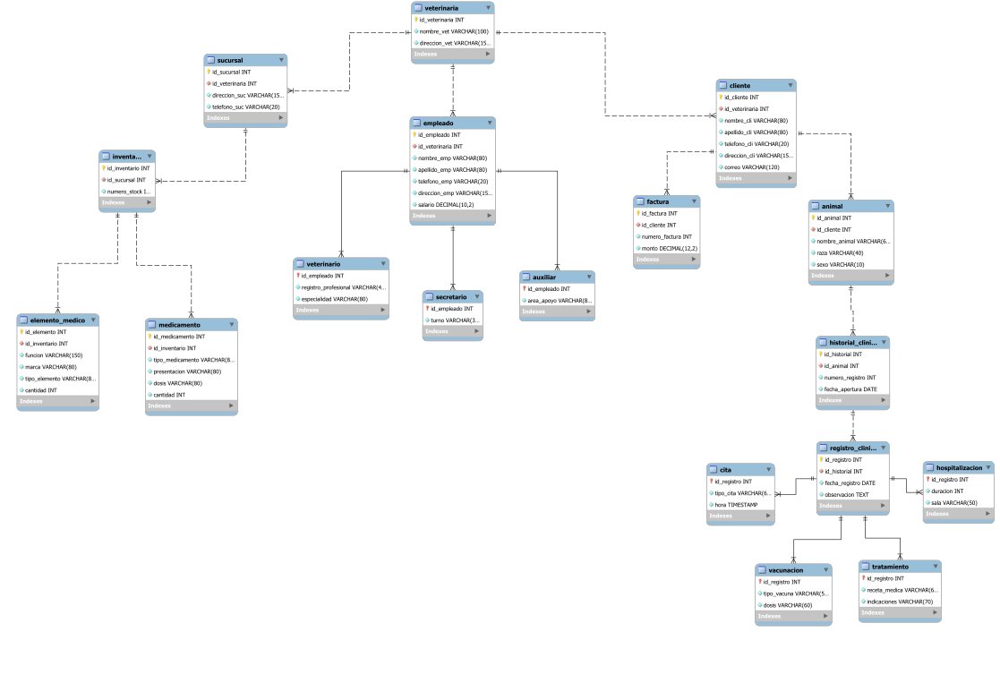

# 3. Modelo relacional y normalización

## Del modelo E-R al modelo relacional

El diseño entidad-relación se transformó en tablas. A cada entidad se le asignó una clave primaria (PK) y las relaciones se representaron mediante claves foráneas (FK), según su cardinalidad.

| Elemento del modelo E-R | Transformación al modelo relacional | Ejemplo de PetManager |
| --- | --- | --- |
| Entidad | Se convierte en una tabla con su PK. | `cliente`, `animal`, `empleado`. |
| Relación 1:N | La FK se ubica en el lado de muchos. | `animal.id_cliente` referencia a `cliente`. |
| Relación 1:1 | Se utiliza una FK con restricción de unicidad. | `historial_clinico.id_animal`. |
| Especialización | El subtipo comparte la PK de la tabla principal y la usa como FK. | `veterinario`, `secretario` y `auxiliar` respecto a `empleado`. |

El modelo E-R representa las entidades y sus relaciones; el modelo relacional organiza esa información en tablas que pueden implementarse en SQL.

## Modelo relacional de 5FN

El modelo relacional está compuesto por **18 relaciones** y **17 claves foráneas**. Esta estructura se implementa en SQL.

### Diagrama del modelo relacional

  

[Ampliar diagrama SVG](https://raw.githubusercontent.com/Stivencaballero0710/Petmanager/main/Sustentaci%C3%B3n/03_Modelo_relacional_y_normalizacion/Modelo_Relacional_PetManager.svg) · [Abrir archivo SVG](./Modelo_Relacional_PetManager.svg) · [Abrir modelo editable en MySQL Workbench (.mwb)](./Modelo_Relacional_PetManager.mwb)

**[Modelo relacional completo](./Modelo_Relacional_5FN.md)**

## Proceso de normalización

El análisis parte de **18 tablas**. Se revisaron las dependencias funcionales, multivaluadas y de reunión para evaluar cada forma normal.

| Forma normal | Criterio revisado | Resultado |
| --- | --- | --- |
| **1FN** | Los atributos almacenan valores atómicos, sin listas ni grupos repetidos en una misma celda. | 18 tablas |
| **2FN** | Los atributos no clave dependen de la clave completa; las claves candidatas consideradas son simples. | 18 tablas |
| **3FN** | Se revisaron dependencias transitivas. Los datos de contacto del cliente quedan en `cliente`; la mascota se relaciona mediante `id_cliente`. | 18 tablas |
| **BCNF** | Los determinantes de las dependencias funcionales no triviales son superclaves. | 18 tablas |
| **4FN** | Se revisaron dependencias multivaluadas independientes. | 18 tablas |
| **5FN** | Se analizaron las dependencias de reunión y se conservó la estructura. | 18 tablas |
| **6FN** | Se descompusieron las relaciones en proyecciones de atributos. | **54 tablas** |

Las **54 tablas de 6FN** corresponden a **18 tablas base y 36 proyecciones adicionales**.

## Resultado y decisión de implementación

| Modelo revisado | Cantidad de tablas | Uso en el proyecto |
| --- | ---: | --- |
| De 1FN a 5FN, incluida BCNF | **18** | Estructura implementada en SQL. |
| 6FN | **54** | Descomposición desarrollada en el proceso de normalización. |

Se implementaron las **18 tablas de 5FN**, que conservan las relaciones definidas para el sistema. La descomposición de 6FN se documenta como una etapa adicional del análisis.

## Documentos relacionados

[Modelo relacional en Excel](../../Modelo%20Relacional/Modelo%20Relacional%20Normalizado/ModeloRelacionalNormalizadoPetManager.xlsx) · [Informe de normalización](../../Modelo%20Relacional/Informe%20de%20Normalizaci%C3%B3n/Informe_Normalizacion_PetManager.pdf)

[Volver al índice](../README.md) · [Siguiente: Esquema SQL](../04_Base_de_datos_en_SQL/)
