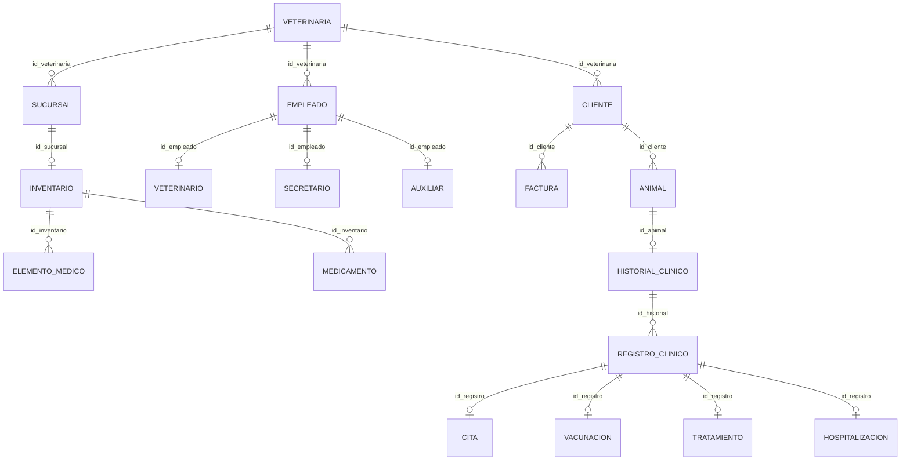

# 3. Modelo relacional y normalización

## Del modelo E-R al modelo relacional

Primero se transformó el diseño entidad-relación en tablas. A cada entidad se le asignó una clave primaria (PK) y las relaciones se representaron mediante claves foráneas (FK), según su cardinalidad.

| Elemento del modelo E-R | Paso al modelo relacional | Ejemplo de PetManager |
| --- | --- | --- |
| Entidad | Se convierte en una tabla con su PK. | `cliente`, `animal`, `empleado`. |
| Relación 1:N | La FK se ubica en el lado de muchos. | `animal.id_cliente` referencia a `cliente`. |
| Relación 1:1 | Se utiliza una FK con restricción de unicidad. | `historial_clinico.id_animal`. |
| Especialización | El subtipo comparte la PK de la tabla principal y la usa como FK. | `veterinario`, `secretario` y `auxiliar` respecto a `empleado`. |

El modelo E-R representa las entidades y sus relaciones; el modelo relacional organiza esa información en tablas que pueden implementarse en SQL.

## Modelo relacional de 5FN

El modelo conserva **18 relaciones** y **17 claves foráneas**, conforme a la hoja `5FN` del Excel y a las tablas creadas en SQL.

### Diagrama del modelo relacional

**[Ver el modelo completo con todos los atributos y sus claves](./Modelo_Relacional_5FN.md)**

Por ejemplo, `ANIMAL` tiene como clave primaria `id_animal` y se relaciona con `CLIENTE` mediante `id_cliente`, evitando repetir los datos del propietario.

## Proceso de normalización

Se partió de **18 tablas**. La finalidad de la normalización fue revisar las dependencias, evitar redundancias innecesarias y mantener la consistencia de la información. **No fue necesario crear tablas nuevas en cada forma normal.**

| Forma normal | Criterio revisado | Resultado |
| --- | --- | --- |
| **1FN** | Los atributos almacenan valores atómicos, sin listas ni grupos repetidos en una misma celda. | 18 tablas |
| **2FN** | Los atributos no clave dependen de la clave completa; en el modelo documentado las claves candidatas consideradas son simples. | 18 tablas |
| **3FN** | Se revisaron dependencias transitivas. Por ejemplo, los datos de contacto del cliente quedan en `cliente`; la mascota se relaciona mediante `id_cliente`. | 18 tablas |
| **BCNF** | Se verificó que, bajo las dependencias declaradas, los determinantes de las dependencias funcionales no triviales son superclaves. | 18 tablas |
| **4FN** | Se revisaron dependencias multivaluadas independientes, sin identificar nuevas descomposiciones bajo los supuestos del informe. | 18 tablas |
| **5FN** | Se analizaron las dependencias de reunión; con las reglas documentadas, se conservó la estructura. | 18 tablas |
| **6FN** | Se desarrolló la descomposición de atributos en relaciones más pequeñas. | **54 tablas** |

**Dato clave de la 6FN:** las **54 tablas** corresponden a **18 tablas base y 36 proyecciones adicionales**. Esta descomposición se presenta como parte del ejercicio de normalización.

## Resultado y decisión de implementación

| Modelo revisado | Cantidad de tablas | Uso en el proyecto |
| --- | ---: | --- |
| De 1FN a 5FN, incluida BCNF | **18** | Estructura elegida para la implementación en SQL. |
| 6FN | **54** | Desarrollo documentado del ejercicio de normalización. |

Se decidió implementar las **18 tablas de 5FN** porque conservan las relaciones previstas y evitan las uniones adicionales que exigiría la versión descompuesta de 6FN. La revisión de las formas normales se basa en las dependencias y reglas de negocio documentadas.

## Documentos relacionados

[Excel del modelo relacional normalizado](../../Modelo%20Relacional/Modelo%20Relacional%20Normalizado/ModeloRelacionalNormalizadoPetManager.xlsx) · [Informe de normalización](../../Modelo%20Relacional/Informe%20de%20Normalizaci%C3%B3n/Informe_Normalizacion_PetManager.pdf)

[Volver al índice de la sustentación](../README.md) · [Siguiente: Esquema SQL](../04_Base_de_datos_en_SQL/)
